# HW1：UART＋DMA 的 AHB／AXI4 介面設計

## HW1：UART＋DMA
AHB／AXI4 介面設計

這份作業以 UART＋DMA 為自選硬體 IP，完成兩種匯流排的 Master／Slave wrapper 有限狀態機、Message Sequence Chart，以及 RTL 自動檢查模擬。

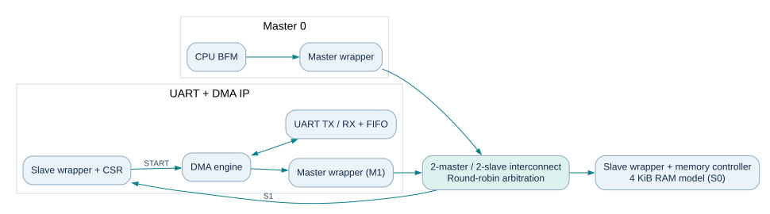

| 元件 | 在系統裡的角色 |
| --- | --- |
| CPU BFM（M0） | 模擬 CPU 發出讀寫要求；用來設定 IP、檢查記憶體。 |
| IP 內部 DMA（M1） | 主動對記憶體發出 SINGLE 或四筆 burst 讀寫。 |
| Memory Controller（S0） | 接收匯流排要求，存取 4 KiB 的簡化 RAM。 |
| IP 控制介面（S1） | 接收 CPU 的暫存器讀寫，設定 UART／DMA。 |

閱讀順序：先看本頁角色，再看第 2 頁設定；第 3-7 頁是第一題，第 8-11 頁是第二題，最後是加分模擬與限制。

搭配專案 README、可編輯圖稿、RTL 原始碼與實際模擬紀錄閱讀。

## 設計範圍與暫存器

同一份 uart_dma 核心分別接 AHB 與 AXI4 wrapper。兩個 Master 共用互連，交易結束時以 round robin 決定下一個使用者。匯流排一次服務一筆交易。

| 項目 | 本作業的選擇 |
| --- | --- |
| AHB | AMBA 2 AHB 的 OKAY／ERROR 子集；有 request／grant。SINGLE 與 INCR4。 |
| AXI | AXI4 memory-mapped 子集；INCR 的 1 或 4 beats，AW／W 獨立握手。 |
| 資料與位址 | 32-bit 資料、4-byte 對齊；每個 beat 位址加 4。每個 Master 最多一筆尚未完成交易。 |
| 記憶體 / IP | RAM：0x00000000-0x00000FFF；IP：0x40000000-0x400000FF。 |
| UART | 8N1；模擬每 bit 8 個時脈。每個 32-bit word 只存一個 UART byte，放在 bits[7:0]。 |

| Offset | 名稱 / 使用方式 |
| --- | --- |
| 0x00 / 0x04 | TXDATA：寫入一個傳送 byte；RXDATA：讀取並移除最舊接收 byte。 |
| 0x08 | STATUS：bit0 busy、bit1 done、bit2 error、bit3 TX busy、bits[7:4] RX FIFO count。 |
| 0x0C / 0x10 | DMA_SRC / DMA_DST：記憶體來源／目的位址。 |
| 0x14 | DMA_LEN：1 或 4，單位是 word。 |
| 0x18 | DMA_CTRL：bit0 START；bit1 方向。寫 1：memory→UART；寫 3：UART→memory。 |

例：來源 0x100、LEN=4，四個 word 的低 byte 為 48、57、31、21（hex），UART 應依序送出「HW1!」。所有 FSM 在時脈上升緣處理；resetn=0 回到 IDLE。圖中未標示的等待條件表示保持原狀態。

## 第一題 A：AHB Master wrapper

Master wrapper 把內部命令轉成 AHB 傳輸。CPU 與 DMA 各有一份，仲裁器決定哪份目前可以驅動匯流排。

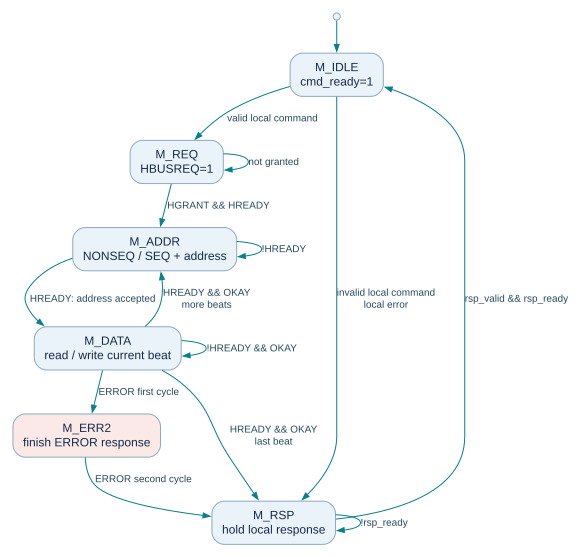

| 狀態 | 白話說明 |
| --- | --- |
| M_IDLE / M_REQ | 先收下整筆命令，再提出 HBUSREQ。HGRANT 且 HREADY 成立時取得使用權。 |
| M_ADDR | 送出位址與控制。第一筆 HTRANS=NONSEQ；後續筆為 SEQ。 |
| M_DATA | 等目前資料階段完成。讀取取樣 HRDATA；寫入維持 HWDATA；只有成功完成才換下一筆。 |
| M_ERR2 / M_RSP | 完成兩拍 ERROR 回覆，再把成功或失敗結果交回內部命令來源。 |

為了容易閱讀，本設計每次分開送位址與資料：非末筆資料階段送 BUSY，末筆送 IDLE。這是保守的 AHB 傳法；INCR4 仍包含四筆實際資料傳輸。等待時維持當前有效訊號。

## 第一題 B：AHB Slave wrapper

Slave wrapper 被位址解碼選中後，鎖存本筆位址與控制，交給 RAM 或 IP 暫存器端點處理，再回傳結果。

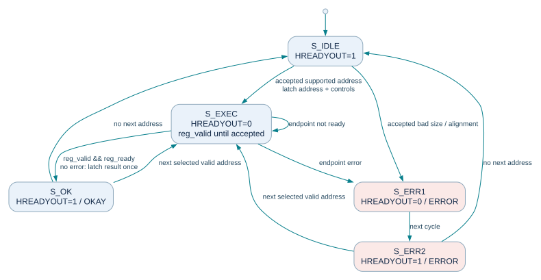

| 訊號 / 狀態 | 要注意的事情 |
| --- | --- |
| 有效要求 | 只有 HSEL、HREADY、HTRANS[1] 同時成立才接受地址。IDLE、BUSY 不會當成有效存取。 |
| S_EXEC | 等內部端點 ready；端點握手只執行一次，先鎖存結果，再回覆匯流排。 |
| S_OK | HREADYOUT=1、HRESP=OKAY；讀取時回傳鎖存的 HRDATA。 |
| S_ERR1 / S_ERR2 | 錯誤回覆分兩拍：第一拍 HREADYOUT=0，第二拍為 1；兩拍 HRESP 都為 ERROR。 |

每次接受新地址時都檢查 SIZE 與對齊；不合法便直接進 S_ERR1（S_OK、S_ERR2 接續新地址時也做同樣檢查）。端點握手後停止重送，避免重複寫入或重複移除 RX FIFO 資料。

## 第一題 C：AXI4 Master wrapper

AXI 將讀寫拆成五個通道。讀取用 AR、R；寫入用 AW、W、B。每個通道都只在 VALID 與 READY 同時為 1 的時脈邊緣傳送成功。

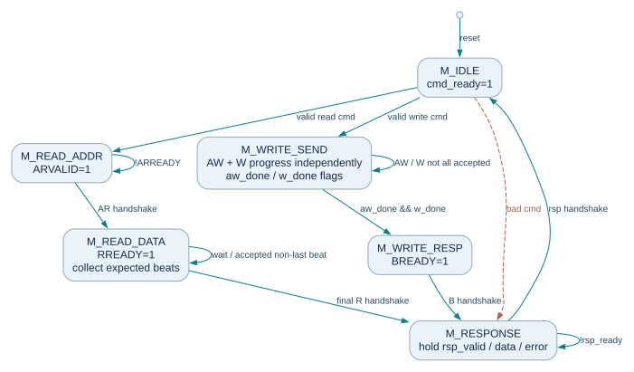

| 工作 | 狀態圖的讀法 |
| --- | --- |
| 讀取 | 先送 AR 位址，再逐筆接收 R 資料。只在 R 握手後增加計數；最後一筆帶 RLAST。 |
| 寫入 | AW 送地址、W 送資料，各自保留完成狀態。兩者可以不同拍完成；最後一筆 W 帶 WLAST。 |
| 寫回覆 | 地址與所有資料送完後，等 B 通道回覆。收到 B 握手才算匯流排寫入完成。 |
| 四筆 burst | AxLEN=3、AxSIZE=2（每筆 4 bytes）、AxBURST=INCR。地址跨 4 KiB 或命令格式錯誤，先在本地拒絕。 |

VALID 已拉高、READY 尚未接受時，該通道的 VALID 和資料必須保持。讀／寫錯誤回傳到本地 rsp_error，再由 DMA 記錄到 STATUS。

## 第一題 D：AXI4 Slave wrapper

Slave 端把 AXI 交易轉成逐筆端點存取。讀取結果與寫入回覆必須保留，直到對方以 READY 接受。

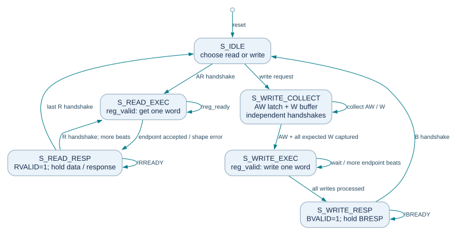

| 工作 | 狀態圖的讀法 |
| --- | --- |
| AR / R | 鎖存讀取地址，向端點要求一筆資料，鎖存後送 R。R 未被接受時不移動到下一筆。 |
| AW / W | 地址和資料分別接受與保存；收齊本筆所需資訊後才執行端點寫入。 |
| B | 所有預期 W 資料和端點操作完成後，才產生一筆 B 回覆。即使 BREADY=0，也保持 BVALID 和 BRESP。 |
| 錯誤 | 未知地址由解碼回覆錯誤；端點錯誤回傳 SLVERR。對 burst 的錯誤處理仍完成該交易要求的資料／回覆流程。 |

本設計只服務一筆交易；這個限制簡化緩衝與路由。AW／W 的接受方式與互連鎖定規則，見 docs/axi_notes.md 與對應 RTL。

## 第一題補充：DMA 與多 Master

下面是 IP 內部的 DMA 控制圖，連接前面四種 wrapper。CPU 啟動 DMA 後，DMA 就成為第二個能主動讀寫記憶體的 Master。

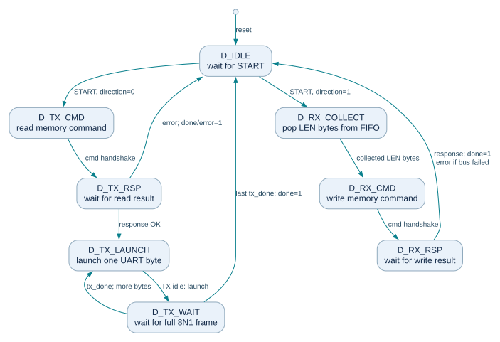

TX：先拿到整個讀取結果，再依序啟動 UART；最後一個字元的 stop bit 完整送完才設定 done。RX：從 RX FIFO 收集 LEN 個 byte，組成 1／4 個 word，送出寫入命令；拿到寫入回覆才設定 done。

仲裁：兩個 Master 同時要求時，優先選上次沒有被服務的那個。交易進行中保留目前擁有者，完成後再換人。AHB 以 request／grant 管理；AXI 互連保留 owner 直到最後 R 或 B 回覆。

可編輯仲裁圖另存 diagrams/07_arbiter.dot 與 .svg。UART FIFO 深度 8 bytes；RX 資料不足時維持等待，直到收齊。

## 第二題 A：AHB 的傳送流程

情境：CPU 先設定 IP，DMA 再從記憶體讀四個 word，交給 UART 傳出「HW1!」。每一條箭頭代表協定事件或一組完成的傳輸，並非每條都剛好一個 clock。

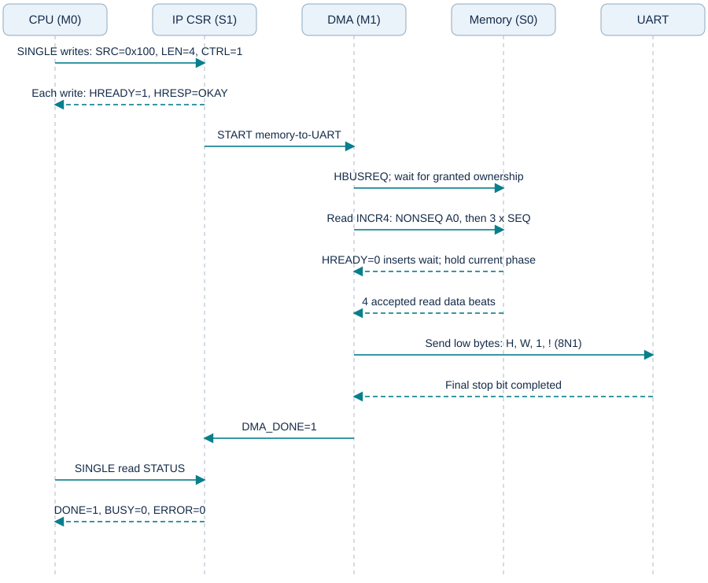

CPU 設定 IP 時是 M0→S1；DMA 讀取記憶體時是 M1→S0。同一個 IP 因而同時具有 Slave 控制介面與 Master 搬移介面。

圖中的 HBUSREQ／HGRANT 由互連仲裁器處理；為了簡化參與者數量，圖將仲裁事件註記在 DMA 的匯流排要求上。HREADY=0 只延長等待，不能當作已完成一筆資料。

## 第二題 B：AHB 的接收流程

情境：CPU 啟動接收 DMA，UART 收到四個 byte 後，DMA 以 INCR4 寫到記憶體 0x200、0x204、0x208、0x20C。

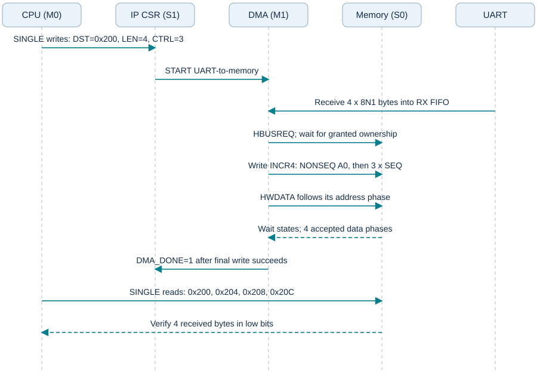

四筆寫入的第一筆是 NONSEQ，另外三筆是 SEQ。地址階段與資料階段屬於不同時間；HWDATA 對應的是已被接受的那筆地址。

最後一筆資料階段成功結束後，DMA 才能回報完成。若 Slave 回覆 ERROR，狀態會同時標示完成與錯誤，CPU 應檢查 STATUS.error。

## 第二題 C：AXI4 的傳送流程

情境相同，將 AHB 讀取換成 AXI4 的 AR 要求與 R 回傳。四筆資料共用一次 AR 地址要求。

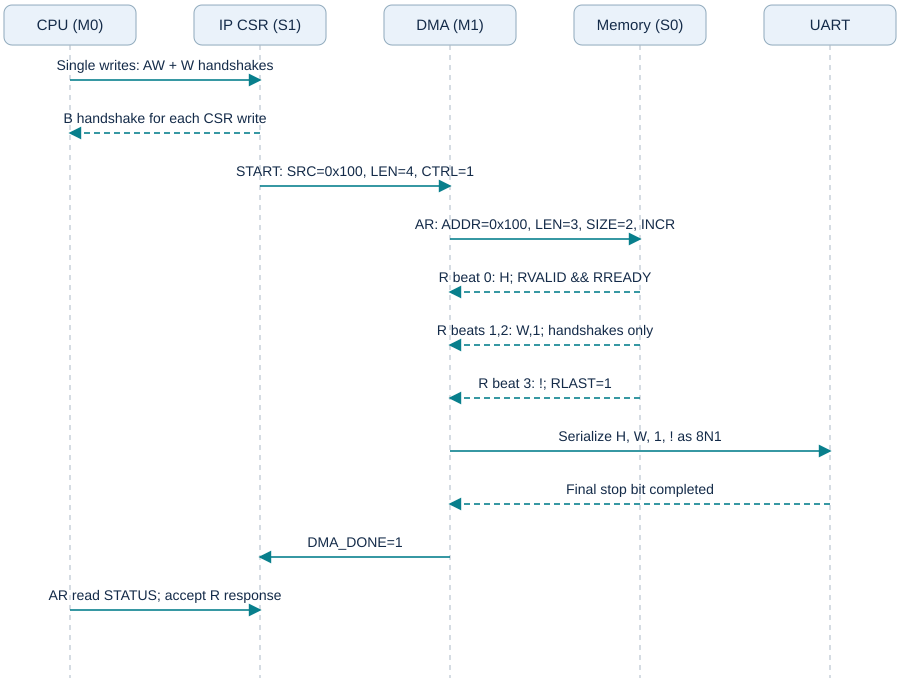

ARLEN=3 代表共 4 beats；ARSIZE=2 代表每筆 4 bytes。R beat 3 必須帶 RLAST。任一拍 RREADY=0，該筆 R 資料與回覆必須保留。

先完整接收四筆資料，再由 UART 逐個字元傳送。此時匯流排交易已可釋放，UART 的位元傳送則繼續進行。

## 第二題 D：AXI4 的接收流程

UART 收滿四個 byte 後，DMA 透過 AW、W 傳送寫入要求。下圖用 AW 先完成作為一種合法範例；AW 與 W 是獨立通道，實作不能假設永遠同拍握手。

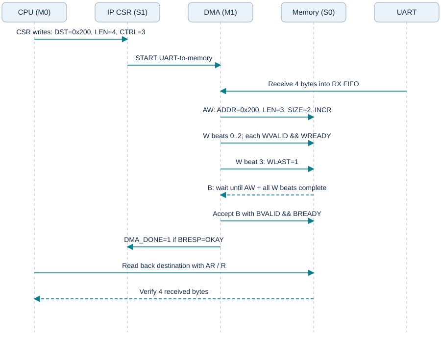

W beat 3 帶 WLAST。Slave 收到地址、所有預期寫入資料且完成端點處理後，才發出 B 回覆。DMA 接受 B 且結果成功，才設定正常完成。

這份作業把每個收到的 byte 放進一個 32-bit word；例如「RX4!」會寫成 0x00000052、0x00000058、0x00000034、0x00000021。

## 加分項：RTL 與自動檢查模擬

這些結果由 SystemVerilog 測試平台實際執行；測試會比對資料與協定行為，發生不符就以失敗結束。完整原始輸出保留在 results/，不以手寫的 PASS 字樣替代。

| 測試平台 | 實際執行結果 |
| --- | --- |
| tb_uart_dma | PASS；941 個自動檢查；6 個 DMA 命令。 |
| tb_ahb | PASS；44 次 INCR4；561 個等待週期；32 個競爭週期；5 次 ERROR。 |
| tb_axi | PASS；332 個自動檢查；AW 先到與 W 先到、R/B/W 等待均有覆蓋。 |

模擬器：Icarus Verilog version 12.0 (devel) (s20150603-1539-g2693dd32b)

| 驗證範圍 | 檢查內容 |
| --- | --- |
| UART＋DMA | 逐 bit 檢查 8N1 的「HW1!」；RX byte 順序、FIFO、DMA 完成時機、錯誤回覆與非法設定。 |
| AHB 整合 | 兩個 Master、兩個 Slave；SINGLE／INCR4；等待狀態；錯誤處理；DMA 與 UART 收發。 |
| AXI 整合 | 兩個 Master、兩個 Slave；單筆／四筆 INCR；五通道握手；回覆等待；DMA 與 UART 收發。 |

### 重新執行

安裝 Icarus Verilog 與 Python 後，在 HW1 資料夾執行：python sim/run_all.py程式會重新編譯三個測試平台、執行測試，並產生 log、VCD、summary.json 和原始碼 SHA-256。

Windows 可使用 C:/iverilog/bin，或透過環境變數 IVERILOG、VVP 指定執行檔。其餘工具只用來製作本份 PDF，重新執行 RTL 模擬不需要安裝。

最後統一執行時間（UTC+8）：2026-10-15T02:00:04.946975+08:00

## 實際波形：UART 傳送

此視窗來自 tb_uart_dma 的實際 VCD，涵蓋第一組四字元 UART 傳送。uart_tx 閒置為 1；每個 frame 由低電位 start 開始，接著 8 個資料 bits、1 個 stop bit。完整檢查由測試平台逐 bit 比對，而非只憑波形外觀判斷。

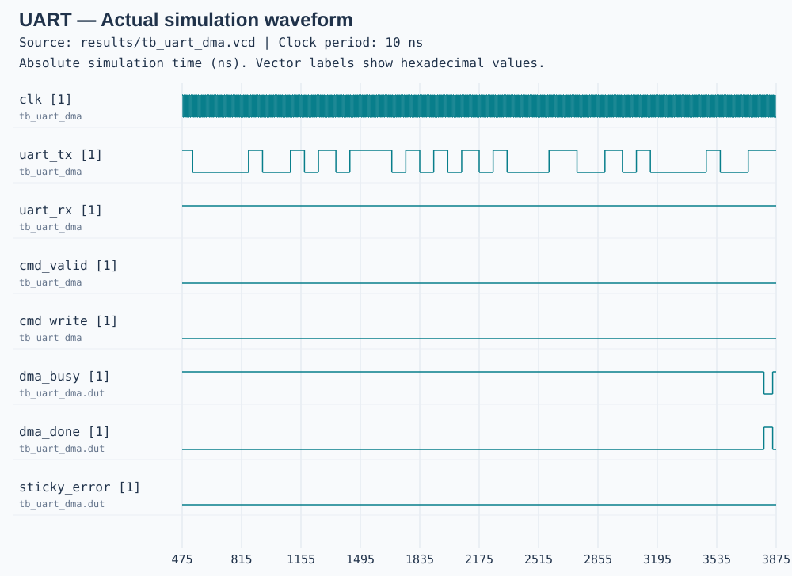

來源：results/tb_uart_dma.vcd。圖左側保留訊號階層名稱，避免同名訊號混淆。

以 GTKWave 開啟原始 VCD 可檢視全部時間與其他訊號；sim/plot_vcd.py 可以從實際 VCD 重新產生這張 SVG。

## 實際波形：AHB 四筆傳輸

此視窗從第一次 INCR4 附近擷取。HTRANS：0=IDLE、1=BUSY、2=NONSEQ、3=SEQ；HREADY=0 表示資料階段尚未完成。圖中可看到保守 FSM 插入 BUSY 以及記憶體端點造成的等待。

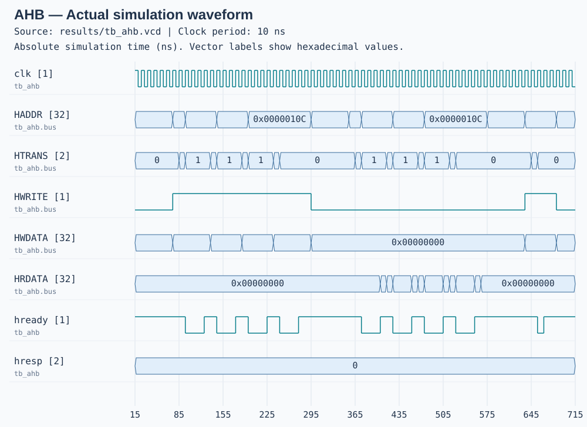

來源：results/tb_ahb.vcd。圖左側保留訊號階層名稱，避免同名訊號混淆。

以 GTKWave 開啟原始 VCD 可檢視全部時間與其他訊號；sim/plot_vcd.py 可以從實際 VCD 重新產生這張 SVG。

## 實際波形：AXI4 四筆讀取

此視窗從一次 ARLEN=3 的讀取要求附近擷取。ARVALID 與 ARREADY 完成位址握手；資料逐筆以 RVALID／RREADY 握手，最後一筆 RLAST=1。波形截圖是完整 VCD 的局部，時間軸使用真實模擬 ns。

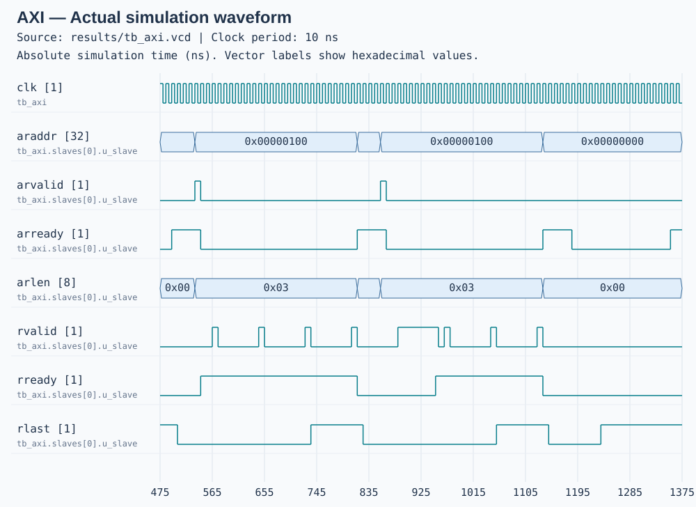

來源：results/tb_axi.vcd。圖左側保留訊號階層名稱，避免同名訊號混淆。

以 GTKWave 開啟原始 VCD 可檢視全部時間與其他訊號；sim/plot_vcd.py 可以從實際 VCD 重新產生這張 SVG。

## 提交內容、限制與參考資料

| 檔案 / 資料夾 | 用途 |
| --- | --- |
| HW1_report.pdf | 本份可直接閱讀的完整作業稿。 |
| README.md / docs/ | 操作方式、報告文字版與各模組詳細設計說明。 |
| diagrams/ | 可編輯 DOT／Mermaid 圖稿，以及可直接檢視的 SVG。 |
| rtl/ / sim/ | AHB、AXI、UART＋DMA 的 RTL，以及自動檢查測試平台。 |
| results/ | 實際執行 log、VCD 波形與可核對原始碼的 summary.json。 |

### 本次實作的範圍

這是供課堂作業理解與模擬的自撰實作。CPU 是 BFM，記憶體控制器是 RAM 模型；未包含完整處理器、外部 DRAM PHY 或 FPGA 板級驗證。AHB 不實作 SPLIT／RETRY／LOCK；AXI 不實作 WRAP、窄傳輸、非對齊、多筆 outstanding 或 out-of-order。

UART 為固定參數的 8N1，沒有 parity、流量控制、中斷與可程式化 baud rate。UART RX 不足 LEN 個 byte 時持續等待；外部送入速度超過 FIFO 容量時會記錄錯誤。

### 參考資料

1. Arm，AMBA Specification Rev 2.0，IHI 0011A：AHB 傳輸、仲裁、burst 與回覆。官方規格連結2. Arm，AMBA AXI and ACE Protocol Specification，IHI 0022H：AXI4 握手、通道、burst 與回覆。官方規格連結3. OpenCores，UART16550：自選 UART IP 的功能參考。本作業 RTL 為自撰，沒有宣稱是 16550 相容核心。專案頁面4. Icarus Verilog：實際使用的 RTL 編譯／模擬工具。官方文件

照片未明訂協定版本、圖的張數與所有選配功能；本報告已明列所採版本與子集。若課堂另有指定版本或格式，再依教師要求調整。
