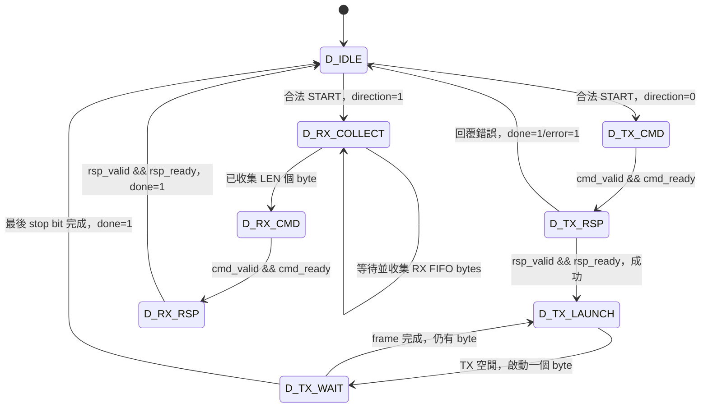

# UART＋DMA 核心：設計與驗證說明

本文件對應 `rtl/uart_dma.sv`、`sim/tb_uart_dma.sv`。核心為本作業自行撰寫的教學 RTL，介面契約見 `interface_contract.md`。AHB、AXI 包裝器共用同一顆核心；CPU 是測試平台內的 BFM。

## 系統角色

- CPU 設定 UART／DMA 暫存器時，本核心是 **Slave endpoint**。
- DMA 存取記憶體時，本核心經 Master wrapper 成為 **Master**。
- UART 實體線傳一個 byte；DMA 匯流排的每個 32-bit word 只使用低 8 bits。RX 寫入的高 24 bits 固定為 0。
- 一次命令搬 1 或 4 個 word。4-word 命令由協定 Master wrapper 轉成真正的 AHB INCR4／AXI4 INCR burst。

## 軟體可見暫存器

暫存器基址為 `0x40000000`；下表列 offset。

| Offset | 名稱 | 讀／寫 | 定義 |
|---|---|---|---|
| 0x00 | TXDATA | W | `reg_strb[0]=1` 時把低 8 bits 送往 UART；TX 或 DMA 忙碌則回覆錯誤 |
| 0x04 | RXDATA | R | 讀取並移除 FIFO 最舊的 byte；FIFO 空、或 RX DMA 進行中則回覆錯誤 |
| 0x08 | STATUS | R | bit0 DMA busy、bit1 done、bit2 error、bit3 UART TX busy、bits7:4 RX FIFO count |
| 0x0C | DMA_SRC | R/W | TX DMA 讀取記憶體的起始 byte 位址 |
| 0x10 | DMA_DST | R/W | RX DMA 寫入記憶體的起始 byte 位址 |
| 0x14 | DMA_LEN | R/W | 允許 1 或 4，單位是 32-bit word；reset 為 4 |
| 0x18 | DMA_CTRL | R/W | 寫 bit0=START；bit1=方向，0：memory→UART，1：UART→memory；讀回 START=0、最近設定的方向 |

SRC、DST、LEN 支援 byte strobe 合併寫入。DMA 忙碌時禁止更改設定或再啟動。CTRL 的低 byte 中 bits7:2 必須為 0；START 只有在 byte lane 0 被選取時生效。

所有暫存器位址必須 4-byte 對齊；未知 offset、錯誤讀寫方向、無效 LEN、忙碌時寫設定及無效 START，均回覆 `reg_error=1`，且不執行副作用。端點以地址低 8 bits 選暫存器，並檢查 bits9:8 必須為 0，避免 AHB 1-KiB 配置內未實作的高 offset 別名到有效暫存器；完整位址範圍由互連解碼。

START 前驗證：選用的 SRC／DST 必須對齊，且所有 1／4 個 word 都落在 `0x00000000–0x00000FFF` 記憶體範圍，UART TX 此時也必須閒置。無效要求不會送出 DMA 命令。已接受的新 START 清除 done／error；因匯流排錯誤結束時，done=1、busy=0、error=1。

## Endpoint 接收規則

`reg_ready` 固定為 1。每個上升緣的 `reg_valid && reg_ready` 代表一筆端點操作；`reg_error=0` 時才執行寫入或 FIFO pop。匯流排包裝器在一次端點握手後必須停止重送同一筆，避免等待匯流排回覆時重複寫入。若 `reg_valid` 連續多拍且 ready=1，每拍依契約都代表新的操作。

## DMA 有限狀態機

`dma_cmd_*` 在命令握手前保持不變；每次僅一個命令尚未完成。`dma_rsp_ready` 只在等回覆狀態為 1。

| 狀態 | 當下工作 | 轉移條件與下一狀態 |
|---|---|---|
| D_IDLE | 等待設定好的 START | 合法 TX START→D_TX_CMD；合法 RX START→D_RX_COLLECT |
| D_TX_CMD | 提出 memory read 命令；valid=1 | `dma_cmd_valid && dma_cmd_ready`→D_TX_RSP |
| D_TX_RSP | 接收整個 1／4-word 的讀取結果 | 握手且無錯→D_TX_LAUNCH；握手有錯→D_IDLE，設定 done/error |
| D_TX_LAUNCH | 等待 TX 引擎空閒，啟動當前 word 的低 byte | `!tx_busy`→D_TX_WAIT |
| D_TX_WAIT | 等完整 8N1 frame 傳完 | `tx_done` 且有下一 byte→D_TX_LAUNCH；最後 byte→D_IDLE，設定 done |
| D_RX_COLLECT | 從 RX FIFO 依序取 byte，放進每個 word 的低 8 bits | 已取得 LEN 個 byte→D_RX_CMD；FIFO 空則等待 |
| D_RX_CMD | 提出 1／4-word memory write 命令；valid=1 | `dma_cmd_valid && dma_cmd_ready`→D_RX_RSP |
| D_RX_RSP | 等寫入結果 | 回覆握手→D_IDLE，設定 done，匯流排錯誤併入 error |

## UART 與 FIFO

UART 為 8N1，閒置高電位，start=0，8 個資料位元由最低位開始，stop=1。波特率由系統時脈除以 `CLKS_PER_BIT` 決定；示範參數為 8，以縮短模擬時間。實機使用者需依時脈／波特率調整，且此實作要求至少 4 個時脈／bit。

TX FSM：`T_IDLE → T_START → T_DATA → T_STOP → T_IDLE`。start、每個資料 bit、stop 各持續完整 `CLKS_PER_BIT` 個時脈。`tx_done` 在整個 stop bit 結束後才脈衝一拍；DMA 再據此決定是否完成。

RX FSM：`R_IDLE → R_START → R_DATA → R_STOP → R_IDLE`。RX 經過兩級同步器，在 start bit 中央確認低電位，接著每隔一個 bit 時間取樣資料和 stop bit。只有有效 stop=1 才把 byte 推入 FIFO；錯誤 stop 設定 error。

RX FIFO 預設 8 bytes，支援同拍 push/pop。FIFO 滿且無 pop 時會丟棄新 byte並設 error。本核心沒有 flow control、parity、UART 中斷或可程式化除頻器。DMA RX 沒有軟體 timeout；接收不足 LEN bytes 時保持 busy，等待剩餘資料。

## 獨立自動檢查模擬

`tb_uart_dma` 將核心接到行為式命令回覆模型，**此測試本身沒有 AHB／AXI 訊號**；兩種匯流排需由各自整合測試驗證。模型每 5 拍才允許接收命令，命令後延遲 11 拍回覆。

已檢查的項目：

1. reset 後 UART 閒置高、空 RXDATA、無效 CSR、不對齊地址、STATUS 寫入錯誤；AHB 1-KiB 配置內高 offset 不得別名到有效 CSR。
2. LEN=2 回覆錯誤並保留原設定；跨記憶體邊界與不對齊 START 不產生 DMA 命令。
3. TX 讀入四個 word，逐 bit 比對 `HW1!`，包含 start／stop，確定最後 stop bit 尚未結束時 done 仍為 0。
4. TX DMA 進行中重複 START、修改設定被拒絕。
5. UART RX 收到 `RX4!` 後，四個 byte 分別寫入四個 word；檢查高 24 bits 全為 0。
6. 先接收四個 byte，確認 FIFO count=4，再啟動 RX DMA，檢查接收順序。
7. 一個 word 的 TX 命令。
8. memory read／write 回覆錯誤傳到 STATUS；失敗 read 不傳出舊資料。

實際執行結果及波形由 `results/tb_uart_dma.log`、`results/tb_uart_dma.vcd` 保留。測試執行目錄為 `results/`，與共用 `sim/run_all.py` 一致。整合時請同時編譯 `rtl/uart_dma.sv`，其中包含 `uart_dma`、`uart_hw1_tx`、`uart_hw1_rx` 三個模組。
