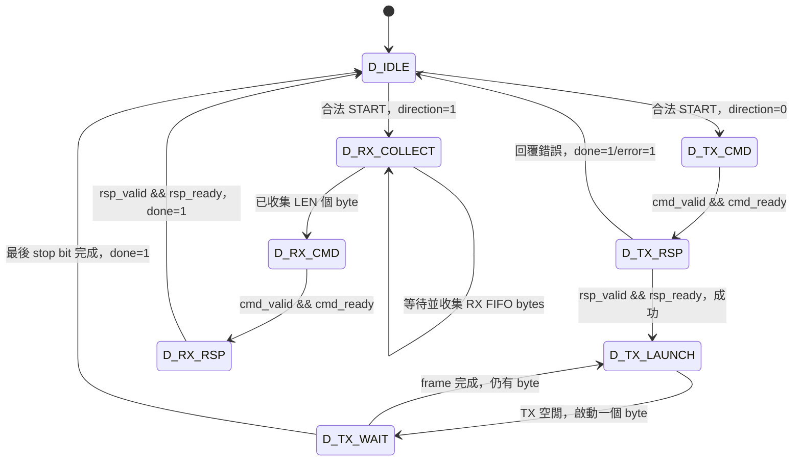

# UART＋DMA 核心：設計與測試說明

這份說明對應 `rtl/uart_dma.sv`、`sim/tb_uart_dma.sv`。核心是這份作業實作的教學 RTL，介面規則整理在 `interface_contract.md`。AHB、AXI wrapper 共用同一顆核心；CPU 則由測試平台裡的 BFM 模擬讀寫行為。

## UART 和 DMA 在系統裡做什麼

- CPU 設定 UART／DMA 暫存器時，核心透過 Slave wrapper 接收要求，是 **Slave**。
- DMA 主動存取記憶體時，則透過 Master wrapper 發出要求，是 **Master**。
- UART 串列線一次傳一個 byte；DMA 匯流排的每個 32-bit word 只使用低 8 bits。RX 寫入記憶體時，高 24 bits 固定為 0。
- 一次命令搬 1 或 4 個 word。4-word 命令會由對應的 Master wrapper 轉成 AHB INCR4／AXI4 INCR burst。

## CPU 可以操作的暫存器

暫存器的起始位址是 `0x40000000`；下表的 offset 是相對於這個位址的偏移量。

| Offset | 名稱 | 讀／寫 | 定義 |
|---|---|---|---|
| 0x00 | TXDATA | W | `reg_strb[0]=1` 時把低 8 bits 送往 UART；TX 或 DMA 忙碌則回覆錯誤 |
| 0x04 | RXDATA | R | 讀取並移除 FIFO 最舊的 byte；FIFO 空、或 RX DMA 進行中則回覆錯誤 |
| 0x08 | STATUS | R | bit0 DMA busy、bit1 done、bit2 error、bit3 UART TX busy、bits7:4 RX FIFO count |
| 0x0C | DMA_SRC | R/W | TX DMA 讀取記憶體的起始 byte 位址 |
| 0x10 | DMA_DST | R/W | RX DMA 寫入記憶體的起始 byte 位址 |
| 0x14 | DMA_LEN | R/W | 允許 1 或 4，單位是 32-bit word；reset 為 4 |
| 0x18 | DMA_CTRL | R/W | 寫 bit0=START；bit1=方向，0：memory→UART，1：UART→memory；讀回 START=0、最近設定的方向 |

SRC、DST、LEN 支援 byte strobe，只有被選到的 byte 會更新，其餘保留原值。DMA 忙碌時，不能更改設定或再次啟動。CTRL 的低 byte 中 bits7:2 必須為 0；START 只有在 byte lane 0 被選取時才生效。

所有暫存器位址都必須 4-byte 對齊。未知 offset、錯誤讀寫方向、無效 LEN、忙碌時寫設定及無效 START，都會回覆 `reg_error=1`，也不會真的寫入、啟動 DMA 或取出 FIFO 資料。核心用位址的低 8 bits 選擇暫存器，同時檢查 bits9:8 必須為 0，避免 AHB 1-KiB 區域內未實作的高 offset，被誤認為有效暫存器。完整位址是否落在這個模組的範圍內，則由互連判斷。

啟動 START 前會先檢查：這次用到的 SRC／DST 必須對齊，所有 1／4 個 word 都要落在 `0x00000000–0x00000FFF` 記憶體範圍內，UART TX 此時也必須閒置。要求無效時，就不送出 DMA 命令。接收到有效的新 START 後，會清除 done／error；若最後因匯流排錯誤而結束，則設成 done=1、busy=0、error=1。

## 內部暫存器怎麼接收要求

`reg_ready` 固定為 1。每個時脈上升緣的 `reg_valid && reg_ready`，都代表一筆內部暫存器操作；只有 `reg_error=0` 時，才真的執行寫入或 FIFO pop（讀取後移除資料）。Wrapper 完成一次內部握手後，就必須停止重送同一筆，避免等待匯流排回覆時又寫入一次。若 `reg_valid` 連續多拍且 ready=1，按照介面規則，每拍都會被當成新的操作。

## DMA 有限狀態機

`dma_cmd_*` 在命令握手前保持不變；要等目前命令完成，才會送下一個。`dma_rsp_ready` 只有在等待回覆的狀態才會設為 1。

| 狀態 | 當下工作 | 轉移條件與下一狀態 |
|---|---|---|
| D_IDLE | 等待設定好的 START | 合法 TX START→D_TX_CMD；合法 RX START→D_RX_COLLECT |
| D_TX_CMD | 提出 memory read 命令；valid=1 | `dma_cmd_valid && dma_cmd_ready`→D_TX_RSP |
| D_TX_RSP | 接收整個 1／4-word 的讀取結果 | 握手且無錯→D_TX_LAUNCH；握手有錯→D_IDLE，設定 done/error |
| D_TX_LAUNCH | 等待 TX 引擎空閒，啟動當前 word 的低 byte | `!tx_busy`→D_TX_WAIT |
| D_TX_WAIT | 等完整 8N1 frame 傳完 | `tx_done` 且有下一 byte→D_TX_LAUNCH；最後 byte→D_IDLE，設定 done |
| D_RX_COLLECT | 從 RX FIFO 依序取 byte，放進每個 word 的低 8 bits | 已取得 LEN 個 byte→D_RX_CMD；FIFO 空則等待 |
| D_RX_CMD | 提出 1／4-word memory write 命令；valid=1 | `dma_cmd_valid && dma_cmd_ready`→D_RX_RSP |
| D_RX_RSP | 等寫入結果 | 回覆握手→D_IDLE，設定 done，匯流排錯誤併入 error |

## UART 怎麼收發，FIFO 怎麼存資料

UART 採用 8N1：閒置時為高電位，start=0，接著從最低位開始傳 8 個資料位元，最後 stop=1。波特率等於系統時脈除以 `CLKS_PER_BIT`；示範參數設為 8，讓模擬比較快跑完。若要用在實機上，需要依時脈與波特率調整，而且這個實作要求至少 4 個時脈／bit。

TX FSM：`T_IDLE → T_START → T_DATA → T_STOP → T_IDLE`。start、每個資料 bit、stop 都會持續完整的 `CLKS_PER_BIT` 個時脈。等整個 stop bit 結束，`tx_done` 才會拉高一拍，DMA 再用這個訊號判斷是否傳完。

RX FSM：`R_IDLE → R_START → R_DATA → R_STOP → R_IDLE`。RX 訊號先經過兩級同步器，再到 start bit 中央確認是否為低電位，接著每隔一個 bit 時間取樣資料和 stop bit。只有確認 stop=1 有效時，才把這個 byte 放進 FIFO；stop 錯誤時則設定 error。

RX FIFO 預設可存 8 bytes，也能在同一拍 push/pop。如果 FIFO 已滿、這一拍又沒有 pop，就會丟棄新 byte 並設定 error。這個核心沒有做 flow control、parity、UART 中斷或可程式化除頻器。DMA RX 也沒有軟體 timeout；若還沒收到 LEN bytes，就會保持 busy，繼續等剩下的資料。

## 核心的獨立模擬測試

`tb_uart_dma` 把核心接到一個模擬命令接收與回覆的行為模型。**這個測試本身沒有 AHB／AXI 訊號**，兩種匯流排另外用各自的整合測試檢查。這個模型每 5 拍才允許接收命令，收到命令後再等 11 拍回覆。

已檢查的項目：

1. reset 後，UART 閒置時是否為高電位；讀空 RXDATA、存取無效 CSR、位址未對齊、寫入 STATUS 時，是否回覆錯誤。也檢查 AHB 1-KiB 區域內的高 offset，不會被誤認為有效 CSR。
2. LEN=2 時是否回覆錯誤並保留原設定；START 的位址若跨記憶體邊界或沒有對齊，是否確實不產生 DMA 命令。
3. TX 讀入四個 word 後，逐 bit 比對 `HW1!`，連 start／stop 都一起檢查，並確認最後 stop bit 還沒結束時，done 仍為 0。
4. TX DMA 進行中，再次 START 或修改設定時，是否被拒絕。
5. UART RX 收到 `RX4!` 後，四個 byte 是否分別寫進四個 word，高 24 bits 是否全為 0。
6. 先接收四個 byte，確認 FIFO count=4，再啟動 RX DMA，檢查取出資料的順序。
7. 一個 word 的 TX 命令是否正常完成。
8. memory read／write 的錯誤是否反映在 STATUS；read 失敗時，是否確實不把舊資料傳出去。

測試結果與波形分別放在 `results/tb_uart_dma.log`、`results/tb_uart_dma.vcd`。測試在 `results/` 目錄執行，和共用的 `sim/run_all.py` 一致。整合時需要一起編譯 `rtl/uart_dma.sv`，裡面包含 `uart_dma`、`uart_hw1_tx`、`uart_hw1_rx` 三個模組。
